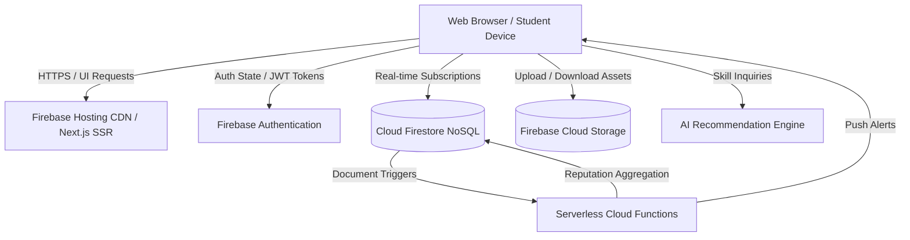

# 🚀 CloudSkill Exchange
### Cloud-Based Student Skill Exchange and Peer Learning Platform
**A B.Tech Cloud Computing Mini Project & Production-Quality Web Application**

---

## 📖 Executive Summary
**CloudSkill Exchange** is a cloud-native peer-to-peer learning platform where university students exchange knowledge directly instead of paying for traditional, expensive tutoring services. 

For instance:
* **Priyan** is proficient in **Figma & Design Systems** and wants to learn **Python Backend Development**.
* **Arun** is an expert in **Python & Distributed APIs** and wants to learn **Figma UI/UX Design**.
* The **CloudSkill Matching Engine** calculates a **96% compatibility score** using a 5-factor weighted algorithm.
* Both students are paired into a private **Exchange Workspace Room** featuring session scheduling with Google Meet links, resource sharing via Cloud Storage, interactive milestone tracking, real-time messaging, and mutual reputation ratings.

---

## ☁️ Cloud Computing Concepts Demonstrated

| Cloud Paradigm | Implementation in CloudSkill Exchange | Cloud Service |
| :--- | :--- | :--- |
| **SaaS Delivery** | Entire application accessible via web browsers with zero client-side installation | Firebase Hosting / Vercel |
| **Authentication as a Service** | University email/password & Google OAuth token verification, role-based claims | Firebase Authentication |
| **Cloud NoSQL Database** | Real-time multi-tenant document store with granular collection security rules | Cloud Firestore |
| **Cloud Object Storage** | Secure cloud buckets for student avatars and exchange study kits (PDF, DOC, ZIP) | Firebase Storage |
| **Serverless Computing** | Event-driven backend functions for match score calculation, triggers & notifications | Firebase Cloud Functions |
| **Elastic Scalability** | Auto-scaling serverless compute and database handling concurrent student sessions | Cloud Run / Serverless |

---

## 🏗️ System & Cloud Architecture



---

## 🧮 5-Factor Smart Skill Matching Algorithm

Compatibility between Student A and Student B is computed through a 5-factor weighted matrix:

$$\text{Score} = w_1 M_{\text{teach}} + w_2 M_{\text{learn}} + w_3 A_{\text{avail}} + w_4 L_{\text{level}} + w_5 I_{\text{campus}}$$

1. **Teaching Skill Match ($w_1 = 40\%$)**: Direct cross-match where User A can teach what User B wants to learn, and User B can teach what User A wants to learn.
2. **Learning Skill Complement ($w_2 = 30\%$)**: Mutual overlap and syllabus balance.
3. **Availability Overlap ($w_3 = 15\%$)**: Synchronous study slots (weekends, weekday evenings).
4. **Skill Level Compatibility ($w_4 = 10\%$)**: Mentor proficiency exceeds or meets learner target difficulty.
5. **Campus & Department Proximity ($w_5 = 5\%$)**: Shared university faculties or academic cohorts.

---

## 🛠️ Tech Stack

* **Frontend**: Next.js 16+ (App Router), React 19, TypeScript, Tailwind CSS, Framer Motion, Lucide Icons
* **Backend & Cloud**: Firebase Auth, Cloud Firestore, Firebase Storage, Firebase Functions, Firebase Hosting
* **Design Language**: Modern SaaS with subtle glassmorphism, responsive cards, and curated typography

---

## 🚀 Getting Started Locally

### 1. Prerequisites
* **Node.js**: v20 or higher
* **npm**: v10 or higher

### 2. Installation
```bash
# Clone the repository
git clone <repo-url>
cd cloude34

# Install dependencies
npm install
```

### 3. Environment Configuration
Copy `.env.example` to `.env.local` and add your Firebase project keys:
```env
NEXT_PUBLIC_FIREBASE_API_KEY=your_api_key
NEXT_PUBLIC_FIREBASE_AUTH_DOMAIN=your_project.firebaseapp.com
NEXT_PUBLIC_FIREBASE_PROJECT_ID=your_project_id
NEXT_PUBLIC_FIREBASE_STORAGE_BUCKET=your_project.appspot.com
NEXT_PUBLIC_FIREBASE_MESSAGING_SENDER_ID=your_sender_id
NEXT_PUBLIC_FIREBASE_APP_ID=your_app_id
```
*(Note: If environment variables are omitted, CloudSkill automatically enables the **Interactive Campus Sandbox Mode** seeded with 8+ demo students, active exchanges, upcoming sessions, and notifications for instant viva examination and grading.)*

### 4. Running the Development Server
```bash
npm run dev
```
Open [http://localhost:3000](http://localhost:3000) in your browser.

---

## 🎯 Viva & Demonstration Walkthrough

1. **Landing Page (`/`)**:
   * View the hero headline, statistics banner, and live exchange card for **Priyan (Figma)** and **Arun (Python)**.
   * Test the **AI-Powered Learning Advisor**: Enter *"I want to become a full-stack developer"* to see roadmap recommendations and matched mentors.
2. **Student Dashboard (`/dashboard`)**:
   * Displays Priyan's overview: Skills taught (4), Skills learning (3), Active exchanges (2), Sessions completed (18), Reputation (4.9 ⭐).
   * Review **Upcoming Sessions** with direct Google Meet links.
3. **Peer Directory (`/discover`)**:
   * Filter students by category (Programming, UI/UX, Cloud, AI/ML), difficulty level, or campus.
   * Click **Exchange** to open the proposal modal and send an exchange request.
4. **Matches & Requests (`/matches`)**:
   * Inspect active exchanges, accept or decline incoming proposals, and browse recommended matches.
5. **Exchange Room Workspace (`/exchange/exchange-priyan-arun`)**:
   * **Overview**: Terms of exchange and matched skills.
   * **Sessions**: Schedule sessions and mark them complete to advance syllabus progress.
   * **Resources**: Download shared PDFs and upload study materials.
   * **Progress**: View real-time percentage completion bars.
   * **Chat**: Send live messages to your peer.
   * **Reviews**: Submit 5-factor ratings.
6. **Admin Control Plane (`/admin`)**:
   * View platform telemetry, popular skill charts, student directories, and moderation controls.
7. **Switching Personas**:
   * Use the **Persona dropdown** in the top navbar to instantly switch between **Priyan Sharma**, **Arun Kumar**, **Ananya Iyer**, and **Kavin Raj** to test bidirectional interactions!
# cloudeproject2
